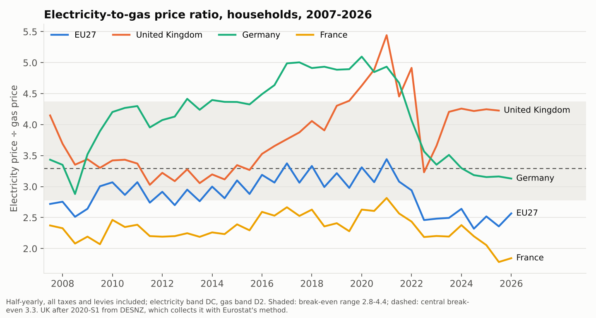
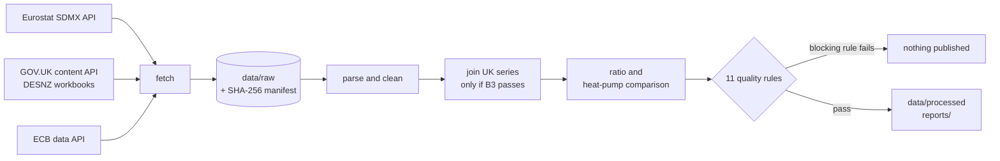

# Electricity-to-gas price ratio for Europe and Great Britain

[](https://github.com/gbadedata/electricity-gas-price-ratio/actions/workflows/ci.yml)
[](https://github.com/gbadedata/electricity-gas-price-ratio/actions/workflows/refresh.yml)

**An open, tested dataset of household electricity and gas prices for 41 European countries from 2007 to 2026, built from Eurostat, DESNZ and ECB data, and the ratio between the two prices that decides whether a heat pump is cheaper to run than a gas boiler.**

A heat pump turns one kWh of electricity into roughly three kWh of heat; a gas boiler turns one kWh of gas into a little under one. So the heat pump wins on running cost when electricity costs less than about 3.3 times as much as gas. That ratio is set by markets, network charges and, above all, by where governments put taxes, levies and support. This repository measures it, country by country and half-year by half-year, and documents every step from the published source to the number.

The UK left Eurostat's household price tables after the first half of 2020. DESNZ still collects UK prices with Eurostat's method and publishes them in its own tables, so the pipeline joins the two, and refuses to do so unless they agree where they overlap.


## What the data shows

From the snapshot of 25 November 2026. The full, regenerated version is in [reports/findings.md](reports/findings.md); every number there is computed from the data on each build.

- **In the first half of 2026 a typical heat pump was cheaper to run than a gas boiler in 18 of the 23 EU countries** that publish both prices. The EU27 ratio was 2.57.
- **The UK ratio was 4.23 in the second half of 2025, second-highest of 24 countries** (the EU27 plus the UK) in that semester, behind only Romania. At that ratio a typical heat pump costs about 28% more to run than a gas boiler.
- **Policy is a large part of the UK gap.** Taxes and levies raise the UK ratio by 24%, from 3.40 to 4.23. Across the EU27 in the same semester they lower it slightly, from 2.43 to 2.36.
- **Two official UK series disagree during the energy crisis.** In most years DESNZ's half-yearly prices sit a few per cent below its separate bills series. In 2023 they sit 17% above it for electricity and 10% for gas, the period of the Energy Price Guarantee. One series states how the guarantee was recorded; the other does not. The UK values for 2022-S2 and 2023-S1 are flagged for that reason.



## The dataset

All files are in [`data/processed/`](data/processed). Column definitions are in [docs/DATA.md](docs/DATA.md).

| File | Rows | What it holds |
|---|---:|---|
| `household_prices.csv` | 67,053 | Every household electricity and gas price by country, half-year, consumption band, tax level and currency, with Eurostat's flags and the source of each value |
| `electricity_gas_ratio.csv` | 13,958 | The ratio for each country, half-year and tax level, with the heat-pump comparison, for two electricity bands |
| `price_components.csv` | 9,755 | Eurostat's annual breakdown of prices into energy, network, taxes, levies and allowances (2017 onwards) |
| `uk_ratio_methods.csv` | 16 | The UK ratio computed three ways: half-yearly average prices, bills series average prices, and unit rates only |
| `uk_series_crosscheck.csv` | 32 | The two DESNZ UK series compared year by year |
| `uk_splice_overlap.csv` | 150 | Every UK value both Eurostat and DESNZ publish, side by side |
| `fx_check.csv` | 439 | Exchange rates implied by Eurostat's euro and national-currency prices against the ECB's |
| `cleaning_log.csv` | 222 | Every value the cleaning rules set to missing, and why |

## Sources

| Source | Publisher | Used for | Licence |
|---|---|---|---|
| [nrg_pc_204](https://ec.europa.eu/eurostat/databrowser/view/nrg_pc_204/default/table) | Eurostat | Household electricity prices, half-yearly, from 2007-S2 | CC BY 4.0 |
| [nrg_pc_202](https://ec.europa.eu/eurostat/databrowser/view/nrg_pc_202/default/table) | Eurostat | Household gas prices, half-yearly, from 2007-S2 | CC BY 4.0 |
| nrg_pc_204_c, nrg_pc_202_c | Eurostat | Annual price components, from 2017 | CC BY 4.0 |
| [QEP 5.6.1-5.6.3, 5.10.1-5.10.3](https://www.gov.uk/government/statistical-data-sets/international-domestic-energy-prices) | DESNZ | UK prices in Eurostat's format after 2020-S1 | OGL v3.0 |
| [QEP 2.2.4, 2.3.4](https://www.gov.uk/government/statistical-data-sets/annual-domestic-energy-price-statistics) | DESNZ | UK unit rates and fixed costs, for the cross-check | OGL v3.0 |
| [EXR](https://data.ecb.europa.eu/data/datasets/EXR) | European Central Bank | Monthly euro reference rates | ECB reuse terms |

DESNZ moves its files to a new URL whenever a table is updated, so the pipeline finds them through the GOV.UK content API by title rather than hard-coding a link.

## How it is built



- **Fetch** downloads every source into `data/raw/` and records its URL, retrieval time, size and SHA-256 in [`manifest.json`](data/raw/manifest.json). A fetch either succeeds for every source or leaves the previous snapshot untouched. Raw files are committed, so any published number can be traced to the exact bytes behind it.
- **Refresh** runs every Monday on GitHub Actions. If no source has changed, it makes no commit. Eurostat publishes household prices twice a year and DESNZ quarterly.
- **CI** rebuilds everything from the committed raw files on each push and fails if the result differs from what is committed.

## Quality rules

Every build runs eleven rules. The three blocking rules stop the build; the eight warnings are reported, with the rows that triggered them, in [reports/validation_report.md](reports/validation_report.md).

| Rule | Check | Result on this snapshot |
|---|---|---|
| B1 | One row per country, half-year, fuel, band, tax level and currency | pass |
| B2 | Prices used in the ratio are above zero and below EUR 2/kWh | pass |
| B3 | DESNZ and Eurostat agree on the UK where both publish | pass: 150 values, largest gap 0.52% |
| W1 | The ratio is the same in euro and in national currency | 4 rounding cases (Georgia) |
| W2 | Tax-inclusive price is at least the tax-exclusive price | 70 cases in 11 countries where support exceeded taxes |
| W3 | Larger consumers don't pay more than smaller ones | 635 cases, mostly bands DD and DE paying more than the band below |
| W4 | Euro prices match national-currency prices at the ECB rate | pass: median gap 0.01% |
| W5 | Ratios built on estimated or provisional values | 32, flag carried into the ratio table |
| W6 | Half-year price moves above 50% | 35, of which 30 in 2021-23 |
| W7 | The two DESNZ UK series agree within 10% | 2023 electricity and gas |
| W8 | EU countries with a ratio in the latest half-year | 23 of 27 |

The tests in [`tests/`](tests) plant a defect for each blocking rule (a duplicated row, a price in cents instead of euro, a UK series shifted by 5%) and a wrong exchange rate for W4, and check that each one is caught.

## Decisions that shape the numbers

The full method, with the reasoning for each choice, is in [docs/METHODS.md](docs/METHODS.md). The ones that matter most:

- **Bands.** Electricity band DC (2,500-4,999 kWh a year) against gas band D2 (20-199 GJ, about 5,600-55,600 kWh). Band DD (5,000-14,999 kWh), closer to a home that heats with electricity, is published as a sensitivity.
- **Average, not marginal, prices.** Eurostat's prices include standing charges spread over each band's consumption. For the UK the pipeline also computes the ratio on unit rates alone (4.01 in 2025, against 4.24 on average prices).
- **Break-even.** A heat pump with a seasonal performance factor of 2.8 (the interim median in the UK's Electrification of Heat trial) against a gas boiler that is 85% efficient on a gross calorific basis (the Energy Saving Trust's field trial measured 82.5-85.3%). Break-even ratio 3.29; the range from a poor heat pump against a good boiler to the reverse is 2.78 to 4.38.
- **Cleaning.** Prices published as exactly zero (household gas in Albania and North Macedonia) are treated as missing. Negative tax-inclusive prices in the smallest electricity bands are real, the result of fixed refunds larger than very small bills, and are kept.

## How AI was used, and how it was checked

The code and documentation were written with an AI coding assistant (Claude Code). The checks that do not depend on trusting it are part of the repository: every value in the findings is computed from the data rather than typed; test values were checked against the Eurostat API by hand; each blocking rule is tested against a planted defect; CI rebuilds every output from the raw files; and the UK series is only joined after it matches Eurostat's on 150 overlapping values. Details in [docs/AI_USE.md](docs/AI_USE.md).

## Limitations

- Heat-pump and time-of-use tariffs, which can lower a heat pump's running cost well below the standard price, are not in these statistics.
- Running cost is one part of the decision. Installation cost, grants and the building matter as much.
- Eurostat does not publish household gas prices for Cyprus, Finland or Malta, and Poland's have been confidential since 2024-S1.
- The UK series lags Eurostat's by about one half-year.

## Reproduce

```bash
pip install -e ".[dev]"
python -m epr verify   # raw files match the manifest
pytest -q              # 17 tests
python -m epr build    # rebuild data/processed and reports from data/raw
python -m epr fetch    # optional: pull fresh data from the sources
```

Python 3.11 or later. No API keys.

## Licence

Code: MIT. Data: each source's own licence, listed above and in the manifest. Please credit Eurostat, DESNZ and the ECB when using the data.
