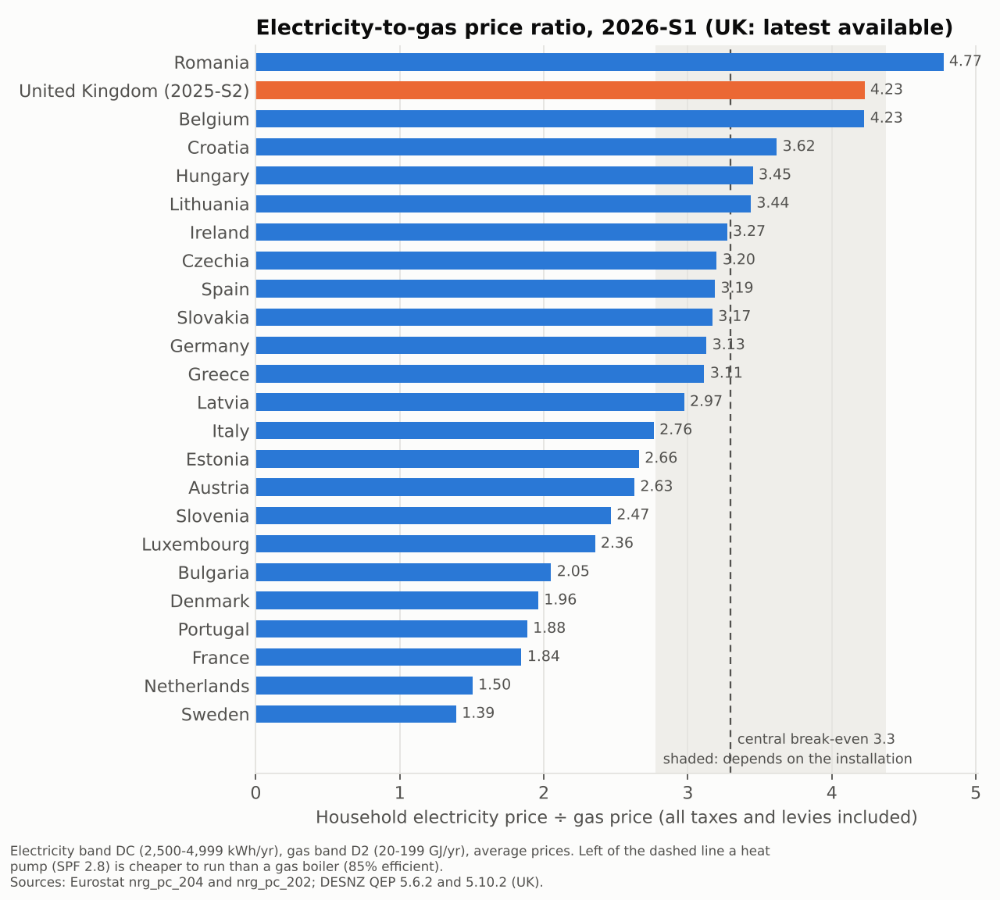
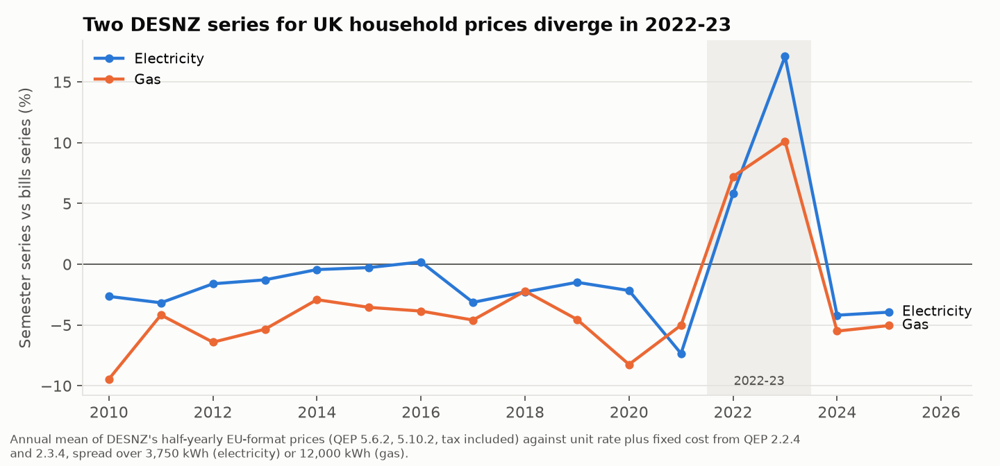
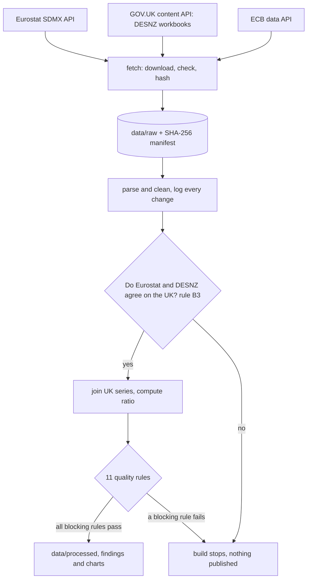

<div align="center">

# Electricity-to-gas price ratio

**Household electricity and gas prices for 41 European countries, 2007-2026, and the one number that decides whether a heat pump is cheaper to run than a gas boiler.**

[](https://github.com/gbadedata/electricity-gas-price-ratio/actions/workflows/ci.yml)
[](https://github.com/gbadedata/electricity-gas-price-ratio/actions/workflows/refresh.yml)


[](LICENSE)

[Findings](reports/findings.md) · [Get the data](#use-the-data) · [Methods](docs/METHODS.md) · [Data dictionary](docs/DATA.md) · [Validation report](reports/validation_report.md)

</div>

---

A heat pump turns one kWh of electricity into about three kWh of heat. A gas boiler turns one kWh of gas into a little under one. So the heat pump is cheaper to run whenever electricity costs less than roughly **3.3 times** the price of gas. That ratio is not set by physics. It is set by wholesale markets, network charges and, above all, by where governments put taxes, levies and support.

This repository builds that ratio for every European country Eurostat covers, half-year by half-year since 2007, and publishes the full chain from source file to number: the raw downloads with their hashes, the cleaning rules and every value they touched, eleven quality checks, and findings that are regenerated from the data on every build.

The UK left Eurostat's tables after the first half of 2020. DESNZ still collects UK prices with Eurostat's method, so the pipeline continues the UK series from DESNZ's tables, but only after checking that the two sources agree on every value they both publish.

## At a glance

<table>
<tr>
<td align="center" width="25%"><h3>18 of 23</h3>EU countries where a typical heat pump was cheaper to run than gas, first half of 2026</td>
<td align="center" width="25%"><h3>2.57</h3>EU27 ratio, 2026-S1: heat from a heat pump cost about 78% of heat from a boiler</td>
<td align="center" width="25%"><h3>4.23</h3>UK ratio, 2025-S2: second-highest in Europe, with taxes and levies adding 24%</td>
<td align="center" width="25%"><h3>17%</h3>gap between DESNZ's two UK electricity series in 2023, against a few per cent in normal years</td>
</tr>
</table>



<sub>Snapshot of 25 November 2026. [reports/findings.md](reports/findings.md) is regenerated whenever a source changes.</sub>

## What the data shows

**1. In most of the EU a heat pump is already the cheaper way to heat.** In 2026-S1 the ratio was below the central break-even of 3.29 in 18 of the 23 EU countries that publish both prices. In 11 of them it was below 2.78, where even a poorly performing heat pump beats a good boiler. Only Romania was above 4.38, where even a good heat pump loses.

**2. The UK is an outlier, and policy is a large part of why.** At 4.23 in 2025-S2, the UK ratio was second of 24 (behind Romania) and well above the EU27's 2.36. A typical heat pump there costs about 28% more to run than a boiler. Taxes and levies raise the UK ratio by 24%, from 3.40 before taxes; across the EU27 they lower it slightly, from 2.43 to 2.36. Even before taxes, though, the UK ratio is higher than the EU's.

**3. Taxes, levies and support decide which side of break-even many countries fall.** Policy costs raise the ratio in 13 of the 24 countries shown, most in the UK (+24%), Croatia and Slovakia (+17% each). They lower it most in the Netherlands (-59%) and Denmark (-38%).

**4. The tax-inclusive price is not always a measure of tax.** Since 2021 Eurostat records government support as negative tax. In 70 cases since 2020 (a country, half-year and consumption band) the price with all taxes included was *below* the price before taxes. For those rows, a "tax effect" is really a support effect, and the validation report lists every one.

**5. Two official UK series disagree during the energy crisis.** DESNZ's half-yearly UK prices normally sit a few per cent below its separate bills series. In 2023 they sit 17% above it for electricity and 10% for gas, while the Energy Price Guarantee applied. One series says how the guarantee was recorded; the other doesn't. The affected half-years are flagged, and the UK ratio is published on both series (3.86 and 3.63 for 2023) instead of silently choosing one.


<details>
<summary><b>Two more charts: the tax effect by country, and the UK cross-check</b></summary>
<br>




</details>

## Use the data

Everything is plain CSV in [`data/processed/`](data/processed), readable straight from GitHub. Full column definitions are in [docs/DATA.md](docs/DATA.md).

```python
import pandas as pd

BASE = "https://raw.githubusercontent.com/gbadedata/electricity-gas-price-ratio/main/data/processed/"

ratio = pd.read_csv(BASE + "electricity_gas_ratio.csv")

# Central case: euro, all taxes included, electricity band DC against gas band D2
central = ratio.query("currency == 'EUR' and tax == 'I_TAX' and elec_band == 'DC'")

central.query("geo == 'UK'").set_index("period")["ratio"].tail(4)
# 2024-S1    4.26
# 2024-S2    4.22
# 2025-S1    4.25
# 2025-S2    4.23
```

| File | Rows | What it holds |
|---|---:|---|
| [`household_prices.csv`](data/processed/household_prices.csv) | 67,053 | Every household electricity and gas price by country, half-year, consumption band, tax level and currency, with Eurostat's flags and the source of each value |
| [`electricity_gas_ratio.csv`](data/processed/electricity_gas_ratio.csv) | 13,958 | The ratio for each country, half-year and tax level, for two electricity bands, with the heat-pump comparison |
| [`price_components.csv`](data/processed/price_components.csv) | 9,755 | Eurostat's annual split into energy, network, taxes, levies, allowances and VAT (2017 onwards) |
| [`uk_ratio_methods.csv`](data/processed/uk_ratio_methods.csv) | 16 | The UK ratio three ways: half-yearly prices, bills-series prices, and unit rates only |
| [`uk_series_crosscheck.csv`](data/processed/uk_series_crosscheck.csv) | 32 | DESNZ's two UK series compared year by year |
| [`uk_splice_overlap.csv`](data/processed/uk_splice_overlap.csv) | 150 | Every UK value both Eurostat and DESNZ publish, side by side |
| [`fx_check.csv`](data/processed/fx_check.csv) | 439 | Exchange rates implied by Eurostat's prices against the ECB's |
| [`cleaning_log.csv`](data/processed/cleaning_log.csv) | 222 | Every value a cleaning rule set to missing, and why |

**Reading the codes.** Periods are half-years (`2026-S1` is January to June). Country codes are Eurostat's, so Greece is `EL` and the UK is `UK`. Tax levels are `X_TAX` (before taxes and levies), `X_VAT` (before VAT) and `I_TAX` (everything included). Electricity band `DC` is 2,500-4,999 kWh a year, `DD` is 5,000-14,999; gas band `D2` is 20-199 GJ, roughly 5,600-55,600 kWh.

## How it works



1. **Fetch.** Every source is downloaded into `data/raw/` and recorded in [`manifest.json`](data/raw/manifest.json) with its URL, retrieval time, size and SHA-256. A fetch either succeeds for every source or leaves the last good snapshot untouched. DESNZ moves its files to a new URL on every update, so they are found through the GOV.UK content API by title rather than by a hard-coded link.
2. **Parse and clean.** Eurostat's SDMX-CSV, DESNZ's Excel workbooks and the ECB's rates become one tidy table. Documented cleaning rules are applied, and every value they touch is logged (see [Method in brief](#method-in-brief)).
3. **Join the UK series.** DESNZ's UK prices take over from Eurostat's after 2020-S1, converted to euro at the ECB semester-average rate, the same convention Eurostat uses.
4. **Validate, then publish.** Eleven rules run. If a blocking rule fails, nothing is written.
5. **Refresh.** A GitHub Actions job runs every Monday. If no source has changed it does nothing; if one has, it rebuilds and commits the new data. Eurostat publishes household prices twice a year and DESNZ quarterly.

## Why you can trust the numbers

**Provenance.** Raw files are committed, so every published number traces back to the exact bytes it came from. Hashes are verified before every build.

**Reproducibility.** On every push, CI rebuilds every table and report from the raw files and fails if the result differs from what is committed.

**Checks that are themselves tested.** Each blocking rule has a test that plants a defect (a duplicated row, a price in cents instead of euro, a UK series shifted by 5%) and confirms it is caught. The values the tests rely on were checked against the Eurostat API directly.

**Eleven quality rules**, with every flagged row listed in the [validation report](reports/validation_report.md):

| | Rule | What it protects against | This snapshot |
|---|---|---|---|
| **B1** | One row per country, half-year, fuel, band, tax level and currency | Duplicates and unknown codes | pass |
| **B2** | Prices in the ratio are above zero and below EUR 2/kWh | Unit and parsing errors | pass |
| **B3** | DESNZ and Eurostat agree on the UK wherever both publish | A splice that shifts the UK series | pass: 150 values, largest gap 0.52% |
| W1 | The ratio is the same in euro and national currency | Fuels converted at different rates | 4 rounding cases |
| W2 | Tax-inclusive price is at least the pre-tax price | Support being read as tax | 70 cases in 11 countries |
| W3 | Larger consumers don't pay more than smaller ones | Mislabelled bands | 635 cases, mostly bands DD and DE |
| W4 | Euro prices match national prices at the ECB rate | Currency conversion errors | pass: median gap 0.01% |
| W5 | Ratios built on estimated or provisional values | Hidden uncertainty | 32, flags kept in the data |
| W6 | Half-year price moves above 50% | Spikes nobody looked at | 35, of which 30 in 2021-23 |
| W7 | DESNZ's two UK series agree within 10% | Inconsistent official sources | 2023, both fuels |
| W8 | EU countries with a ratio in the latest half-year | Silent gaps in coverage | 23 of 27 |

Blocking rules (**bold**) stop the build. Warnings never do: most describe real features of the data that users need to see, not errors to be cleaned away.

## Method in brief

The full reasoning, with the alternatives considered, is in [docs/METHODS.md](docs/METHODS.md).

| Choice | What was done | Why |
|---|---|---|
| Consumption bands | Electricity DC against gas D2, with electricity DD as a sensitivity | DC and D2 are the standard "medium" households; a home with a heat pump uses more electricity and moves up to DD, which lowers the ratio in 21 of 23 EU countries (UK: 4.23 to 3.82) |
| Break-even | Heat-pump SPF 2.8 against an 85% efficient boiler: **3.29**, with a range of 2.78-4.38 | SPF from the interim median of the UK Electrification of Heat trial; boiler efficiency from the Energy Saving Trust's field trial (82.5-85.3%, gross calorific basis, matching Eurostat's gas prices) |
| Average or marginal prices | Average prices, which include standing charges; unit-rate ratio published for the UK | A switching household pays the unit rate at the margin. For the UK in 2025 that gives 4.01 against 4.24 |
| Zeros | Treated as missing | Eurostat publishes 0 for household gas in Albania and North Macedonia, where none is priced |
| Negative prices | Kept | Real: in the smallest bands in the Netherlands and Czechia, fixed refunds exceed very small bills |
| Flags | Kept, carried into the ratio table | Estimated and provisional values are usable if users can see them |

## Sources and licences

| Source | Publisher | Used for | Licence |
|---|---|---|---|
| [nrg_pc_204](https://ec.europa.eu/eurostat/databrowser/view/nrg_pc_204/default/table) | Eurostat | Household electricity prices, half-yearly, 2007-S2 onwards | CC BY 4.0 |
| [nrg_pc_202](https://ec.europa.eu/eurostat/databrowser/view/nrg_pc_202/default/table) | Eurostat | Household gas prices, half-yearly, 2007-S2 onwards | CC BY 4.0 |
| nrg_pc_204_c, nrg_pc_202_c | Eurostat | Annual price components, 2017 onwards | CC BY 4.0 |
| [QEP 5.6.1-5.6.3, 5.10.1-5.10.3](https://www.gov.uk/government/statistical-data-sets/international-domestic-energy-prices) | DESNZ | UK prices in Eurostat's format after 2020-S1 | OGL v3.0 |
| [QEP 2.2.4, 2.3.4](https://www.gov.uk/government/statistical-data-sets/annual-domestic-energy-price-statistics) | DESNZ | UK unit rates and fixed costs, for the cross-check | OGL v3.0 |
| [EXR](https://data.ecb.europa.eu/data/datasets/EXR) | European Central Bank | Monthly euro reference rates | ECB reuse terms |

## Limitations and open questions

- **Heat-pump and time-of-use tariffs** can cut a heat pump's running cost well below the standard price, but official statistics don't cover them.
- **Running cost is one part of the decision.** Installation cost, grants and the building matter as much.
- **Coverage.** Eurostat publishes no household gas prices for Cyprus, Finland or Malta, and Poland's have been confidential since 2024-S1.
- **Timing.** The UK series runs about one half-year behind Eurostat's.
- **Open question for DESNZ:** how was the Energy Price Guarantee recorded in the half-yearly tables (QEP 5.6.x and 5.10.x)? The answer would explain the 2023 gap.

## Roadmap

- [ ] Split the tax effect into taxes and support using Eurostat's price components, so "how much do taxes raise the ratio" can be answered on its own
- [ ] Put the Energy Price Guarantee question to DESNZ and record the answer
- [ ] Add wholesale prices to show how much of the pre-tax ratio comes from the market and how much from networks
- [ ] Add a heat-pump-tariff sensitivity for countries where such tariffs are published
- [ ] Tag a versioned data release with each Eurostat publication

## Run it yourself

```bash
git clone https://github.com/gbadedata/electricity-gas-price-ratio
cd electricity-gas-price-ratio
pip install -e ".[dev]"

python -m epr verify   # raw files match their recorded hashes
pytest -q              # 17 tests, including planted defects
python -m epr build    # rebuild data/processed and reports/ from data/raw
python -m epr fetch    # optional: pull fresh data from every source
```

Python 3.11 or later. No API keys or accounts needed.

<details>
<summary><b>Repository layout</b></summary>

```
├── src/epr/
│   ├── sources.py        every upstream source: URL, publisher, licence
│   ├── fetch.py          download, check, hash, publish the snapshot atomically
│   ├── parse_eurostat.py SDMX-CSV prices and components
│   ├── parse_desnz.py    DESNZ workbooks (UK continuation and bills series)
│   ├── parse_ecb.py      monthly rates, semester averages
│   ├── transform.py      cleaning, UK join, ratio, UK cross-checks
│   ├── validate.py       the eleven quality rules
│   ├── analyse.py        findings text and charts, computed from the data
│   └── assumptions.py    heat-pump and boiler figures, with sources
├── data/raw/             source files as downloaded, plus manifest.json
├── data/processed/       the published dataset
├── reports/              findings, validation report, charts
├── docs/                 methods, data dictionary, AI use
├── tests/                pipeline tests and planted defects
└── .github/workflows/    CI and the weekly refresh
```

</details>

## How AI was used

The code and documentation were written with an AI coding assistant (Claude Code). The checks that matter don't depend on trusting it: findings are computed rather than typed, each blocking rule is tested against a planted defect, CI rebuilds every output from the raw files, and the UK series is only joined after it matches Eurostat on all 150 overlapping values. What the checks caught during the build is recorded in [docs/AI_USE.md](docs/AI_USE.md).

## Citing

If you use this dataset, please cite it with the metadata in [CITATION.cff](CITATION.cff) (GitHub's "Cite this repository" button gives APA and BibTeX), and credit Eurostat, DESNZ and the ECB as the original publishers.

## Licence

Code: [MIT](LICENSE). Data: each publisher's own licence, listed above and in [`manifest.json`](data/raw/manifest.json).

Questions, corrections or a source I've missed? [Open an issue](https://github.com/gbadedata/electricity-gas-price-ratio/issues).
