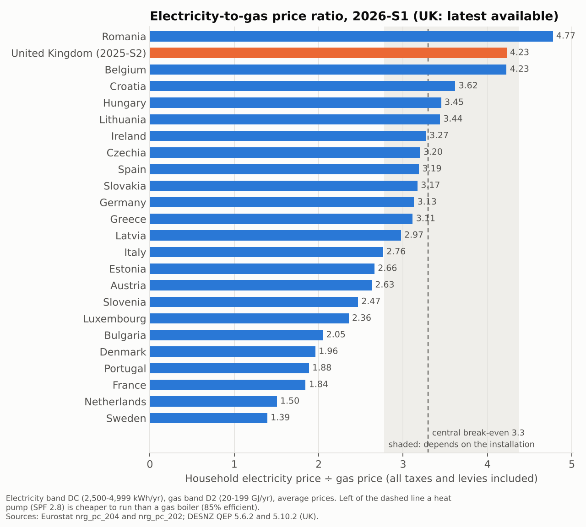
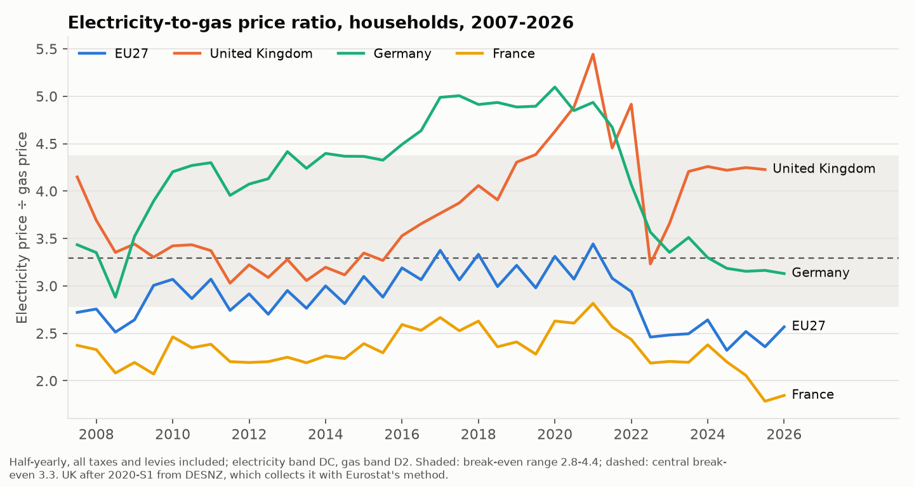
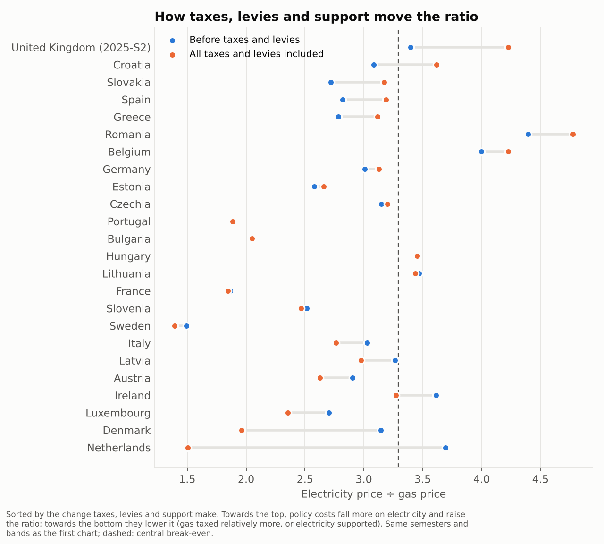
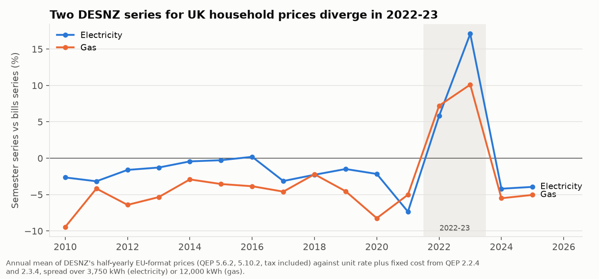

# Findings

Generated from the data on every build. Prices are household averages (all taxes, levies and support included unless stated) for a medium consumer: electricity band DC, gas band D2. A heat pump with a seasonal performance factor of 2.8 is cheaper to run than a gas boiler that is 85% efficient when the electricity-to-gas price ratio is below 3.29. Across plausible installations the break-even runs from 2.78 to 4.38.

## 1. In 2026-S1, a typical heat pump was cheaper to run than gas in 18 of 23 EU countries

- The EU27 ratio was **2.57**, so heat from a typical heat pump cost about 78% of heat from a gas boiler.
- In 11 countries the ratio was below 2.78, where even a poorly performing heat pump beats a good boiler: Sweden, Netherlands, France, Portugal, Denmark, Bulgaria, Luxembourg, Slovenia, Austria, Estonia, Italy.
- 1 EU country was above 4.38, where even a good heat pump loses: Romania.
- 23 of 27 EU countries have both prices in 2026-S1. Missing: Cyprus (no household gas price ever published); Finland (no household gas price ever published); Malta (no household gas price ever published); Poland (gas price confidential since 2024-S1).

## 2. The UK has one of the highest ratios in Europe: 4.23 in 2025-S2

- In 2025-S2 (the UK's latest semester) it ranked 2 of 24 among EU countries and the UK, against 2.36 for the EU27. At this ratio a typical heat pump costs about 28% more to run than a gas boiler. DESNZ's next update of these tables is due 26/11/2026; the weekly refresh picks it up.
- Taxes and levies push the UK ratio up by **24%** (from 3.40 before taxes). Across the EU27 in the same semester they move it the other way: 2.43 before taxes, 2.36 after.
- Even before taxes the UK ratio (3.40) is above the EU27's (2.43).
- Using unit rates only, which is what a household that switches from gas saves per kWh, the UK ratio for 2025 is 4.01, against 4.24 on average prices. Leaving the gas grid also removes the gas standing charge, which this ratio does not count.

## 3. Taxes, levies and support decide which side of break-even many countries fall

- In 13 of 24 countries shown, policy costs raise the ratio; in the rest they lower it.
- Biggest rise: United Kingdom (+24%), Croatia (+17%), Slovakia (+17%).
- Biggest fall: Netherlands (-59%), Denmark (-38%), Luxembourg (-13%).
- In 70 cases since 2020 (a country, semester and consumption band) the price with all taxes included was *below* the price before taxes, because government support or a fixed refund was recorded as negative tax. For those rows the 'tax-inclusive' ratio measures support policy as much as tax (rule W2 lists them).

## 4. A larger electricity user, closer to an electrically heated home, sees a lower ratio

- Using electricity band DD (5,000-14,999 kWh/yr), 19 of 23 EU countries fall below the central break-even in 2026-S1, against 18 on band DC. The UK ratio falls from 4.23 to 3.82.

## 5. Two official UK series disagree during the energy crisis

- In other years DESNZ's half-yearly UK prices (the series that continues Eurostat's) sit a median 4% below its separate bills series. That gap is expected: the bills series covers standard tariffs only and is weighted differently.
- In 2023 the gap jumps to **+17%** for electricity and **+10%** for gas (2022: +6% and +7%). The electricity figure for 2023-S1 is 50.0p/kWh.
- The bills tables state that they incorporate the Energy Price Guarantee (October 2022 to June 2023). The half-yearly tables do not say how UK support was recorded. Until that is confirmed with DESNZ, UK values for 2022-S2 and 2023-S1 should be read with caution. The ratio is less affected because both fuels move: for 2023 it is 3.86 on the half-yearly series and 3.63 on the bills series.

## What this does not show

- Average prices include standing charges spread over each band's consumption, so they are not the marginal price a switching household faces (see finding 2 for the UK unit-rate comparison).
- Heat-pump tariffs and time-of-use pricing, which can cut a heat pump's running cost well below the standard price, are not in these statistics.
- Running cost is not the whole decision: installation cost, grants and the building matter as much.
